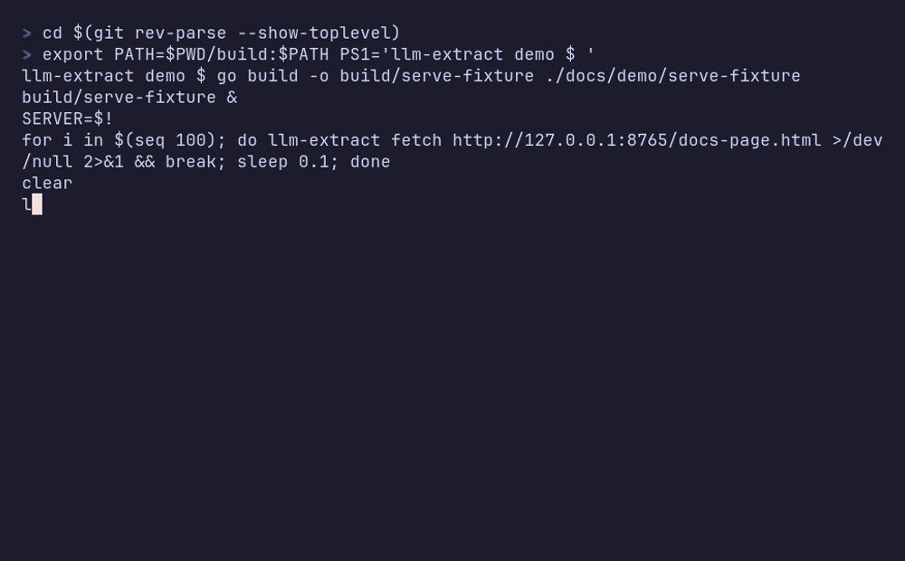

# llm-extract-axi

llm-extract-axi is a single Go binary that gives an AI agent, or you, commands to fetch a web page and pull only what is needed from a large file or page, with [AXI](https://axi.md)-compliant output built for agents to parse.

[](https://github.com/samestrin/llm-extract-axi/actions/workflows/test.yml)
[](https://github.com/samestrin/llm-extract-axi/releases)
[](LICENSE)

## Demo



A real session, recorded from [`docs/demo/llm-extract.tape`](docs/demo/llm-extract.tape) with VHS and committed as a GIF in this repository. It shows `llm-extract --version`, `extract-links --axi` and `extract-links --fields href,score --plain` against the fixture served on `127.0.0.1`. [`docs/demo/README.md`](docs/demo/README.md) gives the render command.

## Why

- Large pages and files do not fit an agent's context. `llm-extract` fetches the content and returns only the part that matters: the ranked links, or the passages relevant to a given context.
- It is the one tool in its family that may reach the network or spend money on a model, and it says which command does which before any call is made.
- A failed fetch or a failed model call is an error, never an empty result. A partial result says it is partial.
- `llm-extract` is the product. `llm-extract-mcp` is an MCP server that shells out to it, a fallback for environments that cannot run a CLI.

## Install

### Release binary

On Linux and macOS, one line, no sudo, no clone, no Go toolchain:

```bash
curl -fsSL https://raw.githubusercontent.com/samestrin/llm-extract-axi/main/install.sh | bash
```

This installs `llm-extract` and `llm-extract-mcp` into `$HOME/.local/bin` (set `INSTALL_DIR` to install elsewhere). The release assets are `llm-extract-<os>-<arch>` and `llm-extract-mcp-<os>-<arch>` for `darwin`/`linux` on `amd64`/`arm64`, plus `llm-extract-windows-amd64.exe` and `llm-extract-mcp-windows-amd64.exe` for Windows. The script downloads the release's `SHA256SUMS.txt` and verifies both binaries against it before either is installed; on an unsupported platform, a failed or stalled download, or a checksum mismatch it installs nothing and leaves an existing install untouched. Windows is not covered by the one-liner; install the `.exe` asset by hand as described below.

Pin a version instead of installing the latest release:

```bash
curl -fsSL https://raw.githubusercontent.com/samestrin/llm-extract-axi/main/install.sh | LLM_EXTRACT_VERSION=v2.1.1 bash
```

If `~/.local/bin` is not on `PATH`, the installer says so and prints the `export` line to add.

To install by hand instead, download `llm-extract-<os>-<arch>` (or `llm-extract-windows-amd64.exe` on Windows) and `SHA256SUMS.txt` from the [latest release](https://github.com/samestrin/llm-extract-axi/releases/latest), verify with `sha256sum -c SHA256SUMS.txt --ignore-missing` (on macOS, `shasum -a 256 -c SHA256SUMS.txt --ignore-missing`), and copy the binary onto `PATH`.

### go install

Requires Go 1.24 or later:

```bash
go install github.com/samestrin/llm-extract-axi/v2/cmd/llm-extract@latest
go install github.com/samestrin/llm-extract-axi/v2/cmd/llm-extract-mcp@latest
```

The binaries land in `$(go env GOPATH)/bin`. The module path ends in `/v2`; the old path without it stops at v1.1.0. The installed binary reports the installed release with `llm-extract --version` (for example `2.1.1`), read from the module version `go install` recorded.

### From source

```bash
git clone https://github.com/samestrin/llm-extract-axi.git
cd llm-extract-axi
make build                    # binaries land in ./build/
./build/llm-extract --version
```

### Agent setup (Claude Code, Codex, OpenCode)

Run `llm-extract setup` in a project (or with `--dir`) to register the tool with all three coding agents:

- **Claude Code**: a SessionStart hook in `.claude/settings.json` and an Agent Skill in `.claude/skills/llm-extract/SKILL.md`.
- **Codex**: a SessionStart hook in `.codex/hooks.json` (Codex hooks are enabled by default; no config edit is written).
- **OpenCode**: a plugin in `.opencode/plugins/llm-extract.js` that adds the home view to each session.

`--target` picks the agents (repeat it or give a comma list, for example `--target claude,codex`); the default is all three. Other settings are kept, a second run changes nothing, and running setup again after the binary moves points the hooks at the new path. `--dry-run` shows what would be written. It writes nothing outside the project directory, and refuses (exit 2) a `--dir` that is your home directory, where the hooks would run in every session, or that does not exist, and a `.claude`, `.codex` or `.opencode` (or a settings file) that is a symlink leading outside the project. A settings file keeps its keys in order, its numbers exactly and its indent. `SKILL.md` and the OpenCode plugin belong to setup: a hand edit to either is overwritten on the next run. The result is a TOON document listing `written[]` and `unchanged[]` (`--json` for JSON, `--plain` for one line per file).

Hook commands are quoted for POSIX sh (macOS and Linux), including paths with spaces or backslashes. Windows shells are not covered: cmd.exe and PowerShell do not read POSIX quoting, so an absolute-path hook may not run there. Keep `llm-extract` on `PATH` on Windows so the hook runs it by bare name.

The same skill is also published for the `skills` CLI:

```bash
npx skills add samestrin/llm-extract-axi --skill llm-extract
npx skills add samestrin/llm-extract-axi --skill llm-extract --agent claude-code -y   # no prompts
```

The skill only runs `llm-extract` by name, so install the binary first (above) and keep it on `PATH`.

### Upgrade

Re-run the install one-liner; it replaces the binaries only after the new download verifies. With Go, re-run the two `go install .../v2/cmd/...@latest` lines above; the old path without `/v2` stops at v1.1.0.

### Uninstall

Delete `llm-extract` and `llm-extract-mcp` from `$HOME/.local/bin` (or the `INSTALL_DIR`). To remove the agent integrations, delete the hook entries `setup` added to `.claude/settings.json` and `.codex/hooks.json`, the `.claude/skills/llm-extract/` directory and the `.opencode/plugins/llm-extract.js` file in the project.

## Quick start

```bash
curl -fsSL https://raw.githubusercontent.com/samestrin/llm-extract-axi/main/install.sh | bash
llm-extract fetch https://example.com
```

Real output (the `body` string trimmed here; every field is shown):

```
body: "<!doctype html><html lang=en><head><meta charset=utf-8>...<title>Example Domain</title>..."
bytes: 577
content_type: text/html; charset=utf-8
final_url: "https://example.com"
format: raw
status: 200
tier: direct
truncated: false
url: "https://example.com"
```

`body` holds the first 4096 bytes of the page, cut on a character boundary; `bytes` is the whole page's size and `truncated` says whether `body` holds less. On a large page, `help[]` names `--full` (the whole body) and `--output <file>` (save the raw bytes to a file).

Then ask for only what you need instead of the whole page:

```bash
llm-extract extract-links --url https://go.dev/doc/
llm-extract extract-relevant --path https://go.dev/doc/install --context "installation steps"
```

## Usage

| Command | What it does |
| --- | --- |
| `llm-extract fetch <url>` | Download a URL with a direct HTTP GET; print a TOON envelope with the first 4096 bytes of the body |
| `llm-extract extract-links --url <url>` | Extract a page's links, ranked, each with text, score and section |
| `llm-extract extract-relevant --path <path> --context <text>` | Pull the parts of files, a directory or a URL relevant to the context, using a model |
| `llm-extract setup` | Register llm-extract with Claude Code, Codex and OpenCode in a project; `--target` picks the agents |

Running `llm-extract` with no arguments prints the reach table below, the path of the binary, a one-line description and the configuration a run would use (whether an API key is set, the model, the base URL, the fetch size cap). It makes no network or model call.

```bash
llm-extract fetch https://example.com --output page.html   # keep a large page out of context
llm-extract fetch https://example.com --full               # the whole body in the envelope
llm-extract fetch https://example.com --json               # the same envelope as JSON
llm-extract extract-links --url https://go.dev/doc/ --json
llm-extract extract-links --url https://go.dev/doc/ --context "modules"   # LLM ranks links by relevance
llm-extract extract-relevant --path ./src --context "API endpoint definitions"
llm-extract extract-relevant --path ./docs --context "configuration options" --concurrency 4 -o out.md
```

Every command takes `--help`. Output is TOON (the AXI token-dense format) by default on the home view, `fetch`, `extract-links`, `extract-relevant` and `setup`, with a `help[]` list of next steps (`fetch` carries one when its body is cut or not text, and a failed fetch carries one too). The global `--plain` flag prints human-readable text instead (`--axi=false` is the same); `--axi` is still accepted and selects the default. `--plain` with `--json` is a usage error (exit 2). A successful `fetch` prints a TOON envelope around the body's first 4096 bytes (`--head N` sets the cut, `--full` the whole body, `--plain` body bytes alone, `--output <file>` saves the whole body to a file and under `--plain` prints `Saved <n> bytes [HTTP <status> via <tier>, <format>] -> <file>` instead of the body), and `completion` stays prose.

## Configuration

The model client is configured entirely through environment variables:

| Name | Default | Meaning |
| --- | --- | --- |
| `OPENAI_API_KEY` / `ANTHROPIC_API_KEY` | unset | API key, required for `extract-relevant` and `extract-links --context`; `OPENAI_API_KEY` wins when both are set |
| `OPENAI_BASE_URL` | `https://api.openai.com/v1` | OpenAI-compatible model endpoint; required when the key is `ANTHROPIC_API_KEY` |
| `OPENAI_MODEL` | `gpt-4o-mini` | Model selection |
| `FETCH_MAX_BYTES` | `16777216` (16 MiB) | Maximum response body size; a larger body is an error |
| `FETCH_TIMEOUT` | `30` | Per-attempt timeout in seconds for `fetch` |
| `FETCH_MAX_RETRIES` | `2` | Retries on connection errors and 5xx for `fetch` |
| `FETCH_USER_AGENT` | unset | Override the request User-Agent for `fetch` |

The client speaks the OpenAI-compatible chat completions API. An `ANTHROPIC_API_KEY` is never sent to the OpenAI default: with that key and no `OPENAI_BASE_URL`, `extract-relevant` stops before any model call with a usage error (exit 2) that names `OPENAI_BASE_URL`, and `extract-links --context` makes no model call and reports the same error beside its unranked links, also exit 2. A missing API key is the same class of error, exit 2, because retrying unchanged cannot help: always in `extract-relevant`, and in `extract-links --context` when the page has links to rank (a page with none needs no model and exits 0). Set `OPENAI_BASE_URL` to the OpenAI-compatible endpoint the key belongs to. The home view reports the same problem as `api_config_error`.

On `fetch`, the flags `--max-bytes`, `--timeout`, `--retries` and `--user-agent` override the matching variable.

## Output and exit codes

Output modes: TOON by default, `--plain` for human-readable text, `--json` for structured output, and `--min` for a token-optimized form. Every error is printed on stdout in the active format — a TOON `error`/`message`/`help[]` document by default, one JSON document under `--json`, an `Error: ...` line under `--plain` (an error carried inside a result, such as a failed `--context` ranking printed beside its links, is that result's `ERROR: ...` line) — and stderr stays empty; a failed `fetch` included. A successful run that finds nothing exits 0 with `total: 0` and a `message`; a failed run carries `error` and exits non-zero (a failed `extract-links --context` ranking keeps its links and `total` beside the `error`). A result built from a cut model input carries a `truncated` note. When a model call answered, the structured output reports `model` and `bytes_sent`. With `extract-relevant -o FILE` the extraction goes to the file: `--plain` prints a short summary, while the default TOON and `--json` print one structured document without the passages.

| Exit code | Meaning |
| --- | --- |
| 0 | Success |
| 1 | The command ran and failed (a failed fetch or model call, or a partial result) |
| 2 | The invocation itself is malformed (an unknown command or flag, a flag missing its argument, a missing `extract-relevant --path`, a rejected flag value such as `fetch --format text`, `fetch --head 0`, `--max-bytes 0`, `--timeout 0`, `--head` with `--full` or with `--output`, an `extract-relevant -o` path that cannot be written, a `setup --dir` that is missing or is home, `--fields` with `--plain` or an unknown `--fields` name, or a URL that is not http or https, the wrong number of arguments such as `fetch` with no URL, `completion` with no shell or an unknown one, `--plain` with `--json`), or the model-key configuration is unusable (no API key, or an `ANTHROPIC_API_KEY` with no `OPENAI_BASE_URL`) in `extract-relevant` or `extract-links --context`; [docs/output.md](docs/output.md#exit-codes) has the full list |

See [docs/output.md](docs/output.md) for the full behavior: partial results, how errors are printed on stdout in each format, and what `llm-extract-mcp` does with a failed run.

## Performance

Generated by [`benchmarks/perf.sh`](benchmarks/perf.sh) from [`benchmarks/results-performance.json`](benchmarks/results-performance.json). The script measures a release binary offline, with the pages served on `127.0.0.1`, and writes `results-performance.json` and `results-performance.md`; the table below is copied from that `.md` by hand, and a test fails when it disagrees with the JSON. The table is re-timed when a release changes what it times (start-up, or `extract-links` reading a page), so its Version line can name an older build than the latest release; it names the build that was measured.

- **Version:** llm-extract 1.0.1-23-g8f6fbb7
- **Date:** 2026-11-13
- **Machine:** Apple M5, 10 threads, 32.0 GiB RAM, macOS 26.2 (arm64), kernel Darwin 25.2.0
- **Method:** 3 warmup and 20 timed runs per case, one after another; timing: wall-clock per process, from start to exit; pages served on 127.0.0.1

| Case | Command | Input | Runs | Median | Mean | Min | Max |
|---|---|---:|---:|---:|---:|---:|---:|
| Cold start | `llm-extract --version` | - | 20 | 4.9 ms | 4.9 ms | 3.7 ms | 6.7 ms |
| Typical command | `llm-extract extract-links --url http://127.0.0.1/docs/getting-started/ --axi` | 15.4 KB | 20 | 6.1 ms | 6.7 ms | 5.4 ms | 11.5 ms |
| Large input | `llm-extract extract-links --url http://127.0.0.1/docs/large/ --axi` | 5.0 MB | 20 | 204.1 ms | 208.3 ms | 190.3 ms | 274.9 ms |

## How it works

`extract-relevant` and `extract-links` are lifted from `llm-data` and behave as they did there. `fetch` is ported from `llm-tools`, direct tier only.

This is the one tool in the family that may go to the network or spend money on a model, and it says which:

| Command | Network | Model |
| --- | --- | --- |
| `fetch` | Always — fetches the URL | Never |
| `extract-links` | Always — fetches the URL | Only with `--context` (LLM link ranking) |
| `extract-relevant` | Only when `--path` is a URL | Always — `--context` is required |
| `setup` | Never | Never |

See [VISION.md](VISION.md) for what the tool is for and what it is not.

## Limits

- `fetch` is a direct HTTP GET only: there is no proxy or browser tier, so a page behind a JavaScript or Cloudflare challenge fails with the reason instead of returning the challenge page.
- `--format` accepts `raw` only; `text` and `markdown` are rejected.
- A response body larger than the size cap (`FETCH_MAX_BYTES`, default 16 MiB) is an error, not a truncated page.
- The model reads a bounded input: `extract-relevant` cuts each prompt at 30,000 bytes, and `extract-links --context` ranks only the first 100 links in a prompt cut at 25,000 bytes. A result built from a cut input carries a `truncated` note. These are fixed input limits on what the model reads, not output truncation; the model commands have no `--full`.
- A successful `fetch` prints a TOON envelope: `bytes` (the whole-body size), `truncated`, and the body's first 4096 bytes, cut on a character boundary. `--head N` sets the cut, `--full` prints the whole body, `--plain` prints body bytes alone (a cut puts a one-line size hint on stderr; with `--output` it prints the `Saved <n> bytes ...` line instead), `--json` prints the same capped document as JSON, `--fields` selects envelope fields, and `--output <file>` saves the whole body to a file. A body that is not UTF-8 text (an image, a PDF) is never printed: `body` is empty, `truncated` is true, and `help[]` points to `--output`. A failed `fetch` prints its error on stdout in the active format, so `fetch URL > file` can hold an error document after a failure — check the exit status.
- `help[]` next steps appear by default (TOON) on the home view, on `fetch` when the body is cut or not text and on a failed fetch, on `setup`, and on `extract-links` and `extract-relevant` results and errors; `--json` output carries no `help[]` and `--plain` is prose.
- An `extract-relevant` directory run skips dotfiles and dot directories (`.env`, `.npmrc`, `.aws/`), `*.env` files, and files named like credentials — `credentials*`, `secret*`, `*token*`, `*.key`, `*.pem`, and service-account files (`*service-account*`, `*service_account*`, `*serviceaccount*`), case ignored — so secrets are not sent to a model; name one as `--path` to read it. `--path` has no default. It reads only regular files whose real path is inside `--path`: a symlink out of it, a FIFO or a device is skipped. The rules go by file name: every other file's contents are sent as they are (a token pasted into `notes.txt` is sent), and `.gitignore` is not read. The result counts every skipped file by reason in `skipped`.
- `setup` registers Claude Code, Codex and OpenCode; there is no session-end hook, because the tool keeps no session state.
- The AXI exceptions behind these limits, with their reasons, are recorded in [docs/axi-audit.md](docs/axi-audit.md).

## Documentation

- [docs/output.md](docs/output.md) — output modes, failure and partial-result behavior, exit codes
- [docs/axi-audit.md](docs/axi-audit.md) — principle-by-principle AXI conformance
- [benchmarks/README.md](benchmarks/README.md) — the token and performance benchmarks and how to rerun them
- [docs/demo/README.md](docs/demo/README.md) — the demo tape, how to render the GIF, and how the replay check works
- [VISION.md](VISION.md) — what the tool is for and what it is not
- [AGENTS.md](AGENTS.md) — house rules for changing this repository

## Development

```bash
make build       # build every binary into ./build/
make test        # build, then go test ./...
make test-race   # build, then the race detector — CI runs this
make lint        # go vet, gofmt -s and golangci-lint
make cover-gate  # build, measure coverage, fail below 80%
make hooks       # opt in to the pre-commit hook
```

The test targets build first because the end-to-end tests run the real binary. CI fails below 80% coverage.

## Support

Support is best effort. Report bugs and request features as [GitHub issues](https://github.com/samestrin/llm-extract-axi/issues); there is no SLA and no guaranteed response time, and the project is maintained in spare time. Pull requests are welcome.

## Changelog

See [CHANGELOG.md](CHANGELOG.md).

## License

MIT — see [LICENSE](LICENSE).
